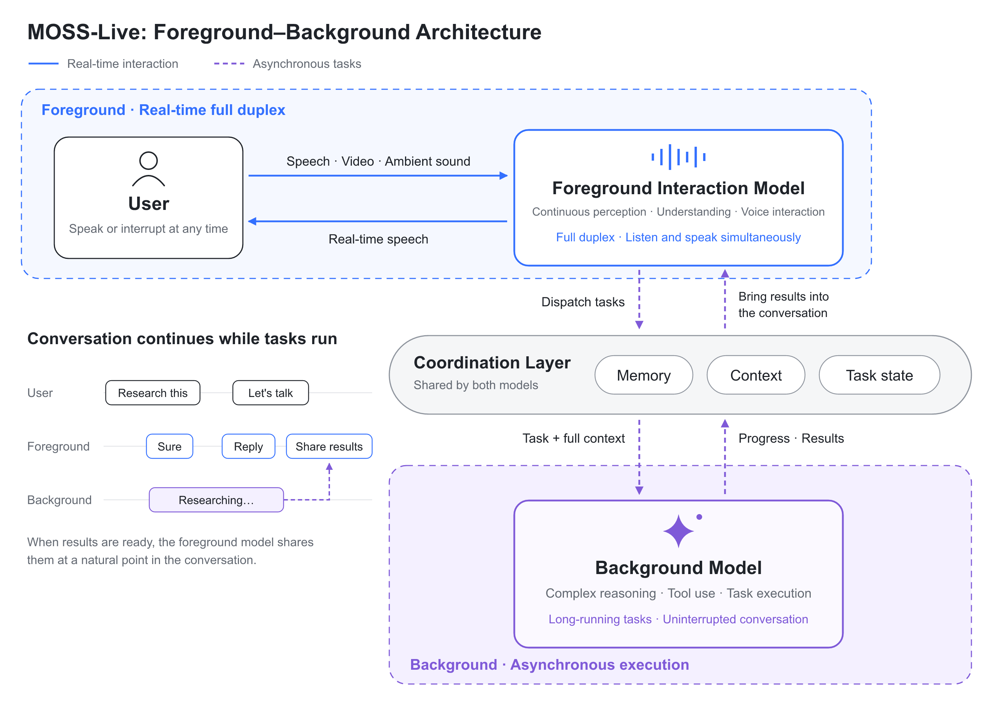
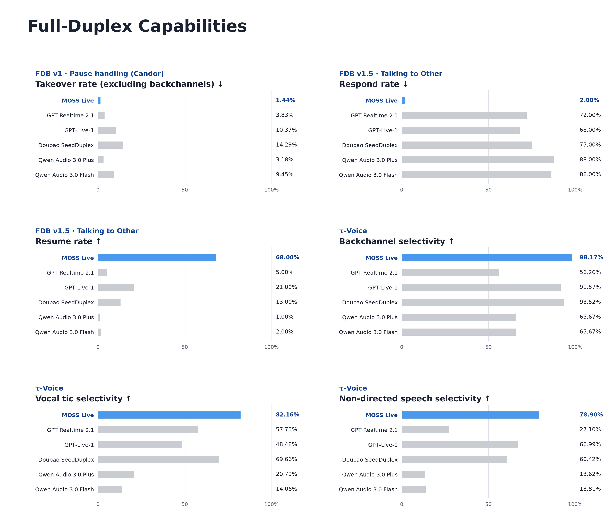
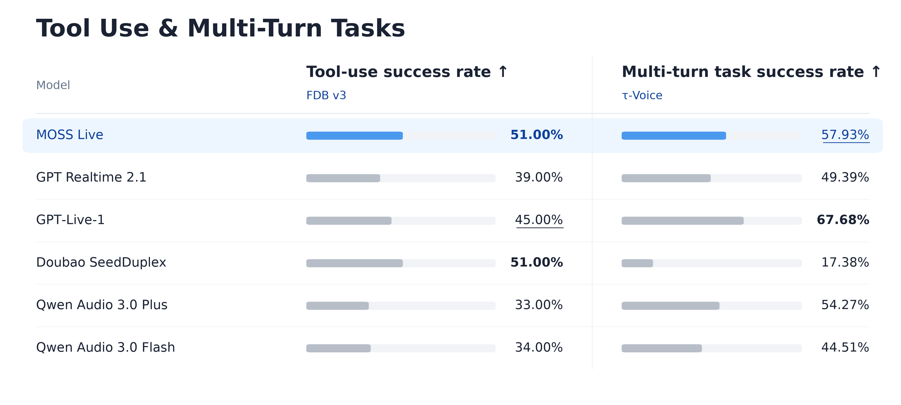
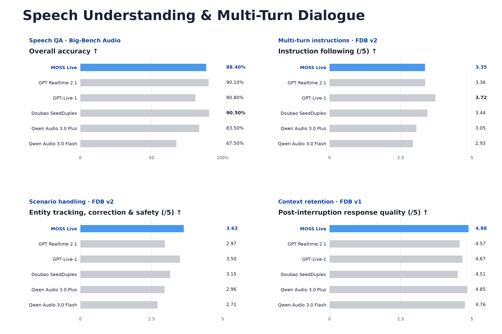

<div align="center">


# MOSS-Live: A Full-Duplex Real-Time Interaction System

**NEVER A DULL MOMENT**

[English](README.md) | [简体中文](README.zh-CN.md)

[Try it live](https://platform.moss.cn/app/playground/) · [Project page](https://www.moss.cn/en/models/moss-live) · [API docs](https://platform.moss.cn/en/docs/scenarios/moss-live/)

</div>

MOSS-Live is a real-time multimodal conversational system built for continuous interaction. It can listen while speaking, follow interruptions and topic changes, understand live visual input, and keep talking while background tools carry out a task.

## Launch film

https://github.com/user-attachments/assets/9fa1341a-a374-4652-9f77-8fad9fab0f18

[Watch in original quality](https://mosi-www-prod-new.oss-cn-shanghai.aliyuncs.com/website/homepage/mova-homepage-showcase-76b7a208f36e4c0e.mp4)

## Capabilities

- **Full-duplex conversation.** Listen and speak at the same time, handle genuine interruptions, and distinguish a thinking pause or a brief “mm-hmm” from a request to take the floor.
- **Selective attention.** Use conversational context to distinguish speech directed at the assistant from background speech and nearby conversations.
- **Continuity across turns.** Follow corrections and topic changes, retain relevant context, and return to an interrupted explanation.
- **Live visual understanding.** Bring camera or screen-sharing input into the same conversation, alongside speech and ambient sound.
- **Tools without a conversational pause.** Dispatch research, reasoning and tool use to the background while the foreground remains available to talk.
- **Streaming interpretation and proactive interaction.** Support concurrent listening and interpretation, and respond to user-defined conditions such as a correction or reminder.

## Architecture

MOSS-Live pairs a foreground interaction model for listening, turn taking and speech with a background model for reasoning, tool calls and longer-running tasks. They share memory, context and task state through a coordination layer, so the conversation can continue while tasks run and results can be brought back at an appropriate moment.



## Demos

### A group meeting

MOSS-Live joins a discussion about planning an event. It looks up weather and major events in Shanghai and Hangzhou while the conversation continues, distinguishes acknowledgments from new questions, and returns to the earlier discussion to summarize decisions and next steps.

https://github.com/user-attachments/assets/3fbc1b5c-02c5-4153-8c54-f968b2cc00c0

[Watch in original quality](https://mosi-www-prod-new.oss-cn-shanghai.aliyuncs.com/website/products/moss-live/video/meeting_room.mp4)

### Planning a road trip

On a two-day trip to Zhoushan, the user changes the plan from hiking to relaxing by the sea. MOSS-Live checks hotels in the background, handles questions about ferries and parking, and keeps track of the changing itinerary while navigation announcements play nearby.

https://github.com/user-attachments/assets/6dd05f9c-2e22-43d8-bb7f-56e6107cbe04

[Watch in original quality](https://mosi-www-prod-new.oss-cn-shanghai.aliyuncs.com/website/products/moss-live/video/driving.mp4)

### Exploring Shanghai

An English-speaking visitor explores Shanghai with MOSS-Live. Through the live camera, it identifies the Peace Hotel, discusses its history, and looks up room and dining information when asked. After a detour, it returns to the story about the building’s green roof.

https://github.com/user-attachments/assets/6d4f47aa-3c31-4dcc-b2ad-87930fea341e

[Watch in original quality](https://mosi-www-prod-new.oss-cn-shanghai.aliyuncs.com/website/products/moss-live/video/city_guide.mp4)

## Evaluation

We evaluate three complementary aspects of the experience: full-duplex behavior, tool use and multi-turn tasks, and speech understanding with conversational continuity. The comparison covers FDB v1, v1.5, v2 and v3, Big-Bench Audio, and τ-Voice.

### Full-duplex capabilities

MOSS-Live has the best score among the compared models on all six interaction metrics shown below. These measure different parts of conversational timing: avoiding premature takeovers, responding selectively to unrelated speech, continuing through irrelevant interruptions, and handling backchannels and vocal tics.



### Tool use and multi-turn tasks

On FDB v3, MOSS-Live achieves **51.00% tool-use success**, tied for the best score in this comparison. On τ-Voice, it achieves **57.93% multi-turn task success**, the second-highest score.



### Speech understanding and multi-turn dialogue

Across Big-Bench Audio and the dialogue evaluations, MOSS-Live combines speech understanding with instruction following, context retention and the ability to handle corrections. Its strengths in this comparison include post-interruption response quality and the FDB v2 composite covering entity tracking, correction and safety. Together, these abilities help a conversation stay coherent as questions, requirements and topics change.



<details>
<summary>Full benchmark results · 6 benchmarks · 36 metrics</summary>

### FDB v1

| Metric | MOSS-Live | GPT Realtime 2.1 | GPT‑Live-1 | Doubao SeedDuplex | Qwen Audio 3.0 Plus | Qwen Audio 3.0 Flash |
| :--- | ---: | ---: | ---: | ---: | ---: | ---: |
| Turn-over rate · synthetic pause handling ↓ | 2.92% | <ins>2.19%</ins> | 6.57% | 4.38% | **1.46%** | <ins>2.19%</ins> |
| Turn-over rate · Candor pause handling ↓ | 10.19% | **2.31%** | 36.11% | 12.96% | <ins>3.24%</ins> | 8.80% |
| Turn-over rate · backchannel listening ↓ | **0.00%** | 1.85% | 3.64% | 7.27% | <ins>1.82%</ins> | <ins>1.82%</ins> |
| Backchannel frequency ↑ | <ins>0.0234 Hz</ins> | 0.0099 Hz | **0.0986 Hz** | 0.0107 Hz | 0.0013 Hz | 0.0026 Hz |
| Backchannel timing JSD ↓ | <ins>0.8873</ins> | 0.9624 | **0.7598** | 0.9728 | 0.9914 | 0.9815 |
| Turn-over rate · Candor turn taking ↑ | 84.03% | **100.00%** | 98.32% | <ins>99.16%</ins> | <ins>99.16%</ins> | **100.00%** |
| Response latency · Candor turn taking ↓ | <ins>1.14 s</ins> | 1.50 s | **0.78 s** | 1.86 s | 1.59 s | 1.36 s |
| Turn-over rate · user interruption ↑ | 98.50% | **100.00%** | **100.00%** | <ins>99.50%</ins> | **100.00%** | **100.00%** |
| Post-interruption response quality ↑ | **4.88 / 5** | 4.57 / 5 | 4.67 / 5 | 4.51 / 5 | <ins>4.85 / 5</ins> | 4.76 / 5 |
| Response latency · user interruption ↓ | 1.38 s | <ins>1.26 s</ins> | **1.04 s** | 1.73 s | 1.62 s | 1.49 s |
| Takeover rate excluding backchannels · Candor pause handling ↓ | **1.44%** | 3.83% | 10.37% | 14.29% | <ins>3.18%</ins> | 9.45% |

### FDB v1.5

| Metric | MOSS-Live | GPT Realtime 2.1 | GPT‑Live-1 | Doubao SeedDuplex | Qwen Audio 3.0 Plus | Qwen Audio 3.0 Flash |
| :--- | ---: | ---: | ---: | ---: | ---: | ---: |
| Respond rate · User Interruption ↑ | 84.50% | 82.00% | 89.00% | 83.00% | **97.50%** | <ins>97.00%</ins> |
| Resume rate · User Interruption ↓ | 2.50% | 11.50% | 7.50% | 12.50% | **0.50%** | <ins>1.50%</ins> |
| Respond rate · User Backchannel ↓ | **0.00%** | <ins>2.04%</ins> | 3.06% | **0.00%** | 15.31% | 7.14% |
| Resume rate · User Backchannel ↑ | 61.22% | 91.84% | <ins>95.92%</ins> | **98.98%** | 36.73% | 39.80% |
| Respond rate · Talking to Other ↓ | **2.00%** | 72.00% | <ins>68.00%</ins> | 75.00% | 88.00% | 86.00% |
| Resume rate · Talking to Other ↑ | **68.00%** | 5.00% | <ins>21.00%</ins> | 13.00% | 1.00% | 2.00% |
| Respond rate · Background Speech ↓ | **10.00%** | 81.00% | 68.00% | <ins>66.00%</ins> | 95.00% | 74.00% |
| Resume rate · Background Speech ↑ | **51.00%** | 7.00% | 22.00% | <ins>31.00%</ins> | 0.00% | 0.00% |

### FDB v2

| Metric | MOSS-Live | GPT Realtime 2.1 | GPT‑Live-1 | Doubao SeedDuplex | Qwen Audio 3.0 Plus | Qwen Audio 3.0 Flash |
| :--- | ---: | ---: | ---: | ---: | ---: | ---: |
| Turn-taking fluency ↑ | **4.52 / 5** | <ins>4.15 / 5</ins> | 4.13 / 5 | 4.04 / 5 | 4.04 / 5 | 3.96 / 5 |
| Multi-turn instruction following ↑ | 3.35 / 5 | 3.36 / 5 | **3.72 / 5** | <ins>3.44 / 5</ins> | 3.05 / 5 | 2.93 / 5 |
| Entity tracking, correction & safety ↑ | **3.63 / 5** | 2.97 / 5 | <ins>3.50 / 5</ins> | 3.15 / 5 | 2.96 / 5 | 2.71 / 5 |

### FDB v3

| Metric | MOSS-Live | GPT Realtime 2.1 | GPT‑Live-1 | Doubao SeedDuplex | Qwen Audio 3.0 Plus | Qwen Audio 3.0 Flash |
| :--- | ---: | ---: | ---: | ---: | ---: | ---: |
| Tool-use success rate ↑ | **51.00%** | 39.00% | <ins>45.00%</ins> | **51.00%** | 33.00% | 34.00% |
| Tool selection F1 ↑ | <ins>95.68%</ins> | 91.29% | 80.37% | **96.99%** | 78.75% | 87.30% |
| Argument accuracy ↑ | <ins>72.17%</ins> | 61.00% | 68.50% | **75.00%** | 59.67% | 61.00% |
| Semantic task success rate ↑ | <ins>66.00%</ins> | 55.00% | 63.00% | **67.00%** | 53.00% | 54.00% |
| Post-tool response quality ↑ | <ins>83.00%</ins> | 72.00% | 74.00% | **89.00%** | 67.00% | 70.00% |
| Response latency in tool-use scenarios ↓ | <ins>2.36 s</ins> | **1.61 s** | 3.46 s | 5.11 s | 2.54 s | 2.85 s |

### Big-Bench Audio

| Metric | MOSS-Live | GPT Realtime 2.1 | GPT‑Live-1 | Doubao SeedDuplex | Qwen Audio 3.0 Plus | Qwen Audio 3.0 Flash |
| :--- | ---: | ---: | ---: | ---: | ---: | ---: |
| Overall accuracy ↑ | 88.40% | <ins>90.10%</ins> | 80.80% | **90.50%** | 83.50% | 67.50% |

### τ-Voice

| Metric | MOSS-Live | GPT Realtime 2.1 | GPT‑Live-1 | Doubao SeedDuplex | Qwen Audio 3.0 Plus | Qwen Audio 3.0 Flash |
| :--- | ---: | ---: | ---: | ---: | ---: | ---: |
| Multi-turn task success rate (pass¹) ↑ | <ins>57.93%</ins> | 49.39% | **67.68%** | 17.38% | 54.27% | 44.51% |
| Backchannel selectivity ↑ | **98.17%** | 56.26% | 91.57% | <ins>93.52%</ins> | 65.67% | 65.67% |
| Vocal tic selectivity ↑ | **82.16%** | 57.75% | 48.48% | <ins>69.66%</ins> | 20.79% | 14.06% |
| Non-directed speech selectivity ↑ | **78.90%** | 27.10% | <ins>66.99%</ins> | 60.42% | 13.62% | 13.81% |
| Response rate ↑ | 94.49% | 86.28% | **99.02%** | 87.79% | 95.00% | <ins>95.24%</ins> |
| Yield rate within 2 s ↑ | 52.49% | 76.72% | 26.33% | 46.05% | <ins>93.38%</ins> | **96.28%** |
| Agent interruption rate ↓ | <ins>9.18%</ins> | 26.74% | 10.13% | **7.86%** | 23.76% | 20.49% |

</details>

## Get started

Try MOSS-Live in the [online playground](https://platform.moss.cn/app/playground/), or integrate it into your application with the [realtime API guide](https://platform.moss.cn/en/docs/scenarios/moss-live/).

Plan a trip, change your mind halfway through, or turn on the camera and talk about what you see.


## Citation

If you use MOSS-Live in your research or projects, please cite:

```bibtex
@misc{openmoss2026mosslive,
  title  = {{MOSS-Live}: A Full-Duplex Real-Time Interaction System},
  author = {{OpenMOSS}},
  year   = {2026},
  url    = {https://github.com/OpenMOSS/MOSS-Live}
}
```
