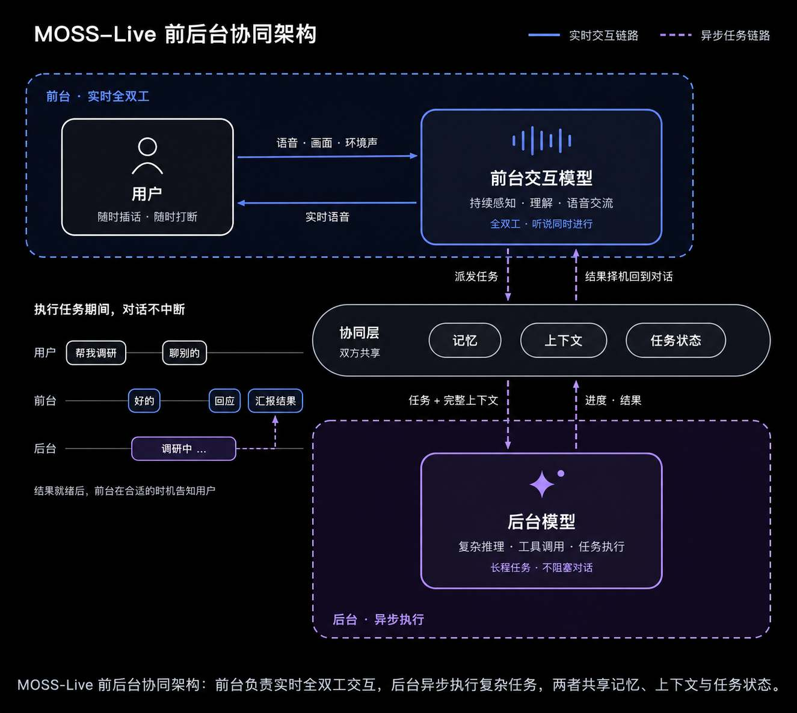
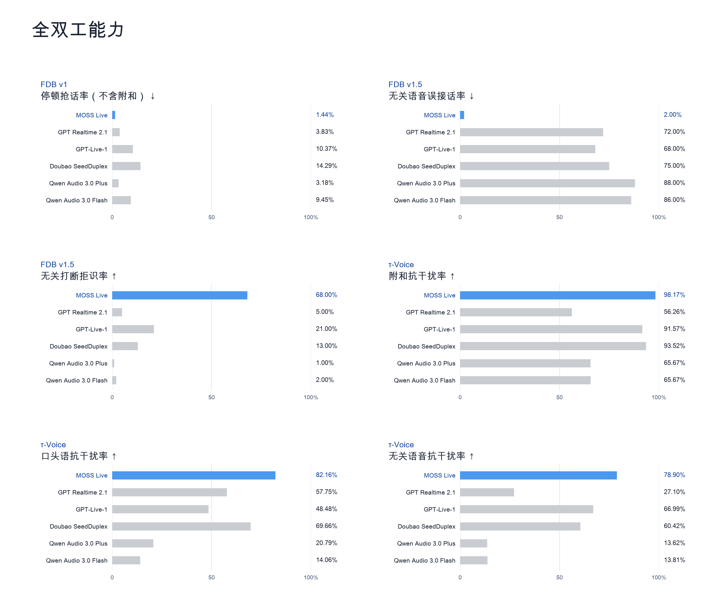
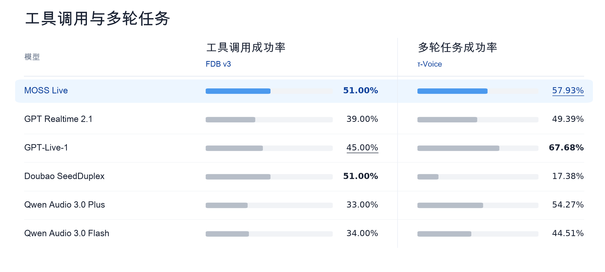
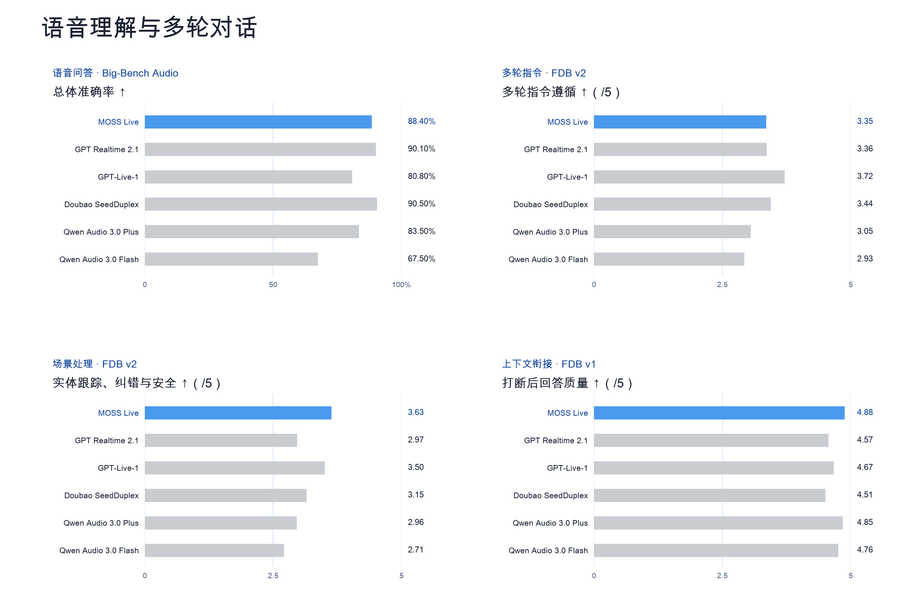

<div align="center">


# MOSS-Live：全双工实时交互系统

**NEVER A DULL MOMENT**

[English](README.md) | [简体中文](README.zh-CN.md)

[在线体验](https://platform.moss.cn/app/playground/) · [模型介绍](https://www.moss.cn/models/moss-live) · [API 文档](https://platform.moss.cn/en/docs/scenarios/moss-live/)

</div>

MOSS-Live 是面向持续交流的实时多模态对话系统。它可以边听边说，跟进打断与话题变化，理解实时画面，并在后台执行任务的同时继续与用户交流。

## 宣传片

https://github.com/user-attachments/assets/9fa1341a-a374-4652-9f77-8fad9fab0f18

[观看原画质宣传片](https://mosi-www-prod-new.oss-cn-shanghai.aliyuncs.com/website/homepage/mova-homepage-showcase-76b7a208f36e4c0e.mp4)

## 核心能力

- **实时全双工。** 听和说同时进行，区分真正的打断、思考时的停顿和简短附和，把握接话与让话的时机。
- **无关语音拒识。** 结合对话上下文，区分对自己说的话、旁人的交谈和背景语音。
- **多轮对话连续性。** 跟进纠正与话题变化，保留上下文，也能在被打断后接着讲。
- **实时视觉理解。** 将摄像头或屏幕共享画面，与语音、环境声放在同一段交流中理解。
- **工具执行时继续交流。** 查询、推理和工具调用在后台推进，前台仍能随时听取新问题。
- **流式同传与主动交互。** 支持边听边译，也可根据用户设定的条件进行纠错或提醒。

## 前后台协同架构

MOSS-Live 的前台交互模型负责倾听、理解和语音交流，后台模型负责复杂推理、工具调用和长程任务。两者通过协同层共享记忆、上下文和任务状态，让任务在后台推进、对话持续进行，并在合适的时机将结果带回交流。



## 场景 Demo

### 多人会议

大家讨论活动方案时，MOSS-Live 一边查询上海、杭州的天气和同期大型活动，一边继续参与讨论。它区分附和与新的提问，在话题切换后回到之前的上下文，并整理结论与待办。

https://github.com/user-attachments/assets/3fbc1b5c-02c5-4153-8c54-f968b2cc00c0

[观看原画质视频](https://mosi-www-prod-new.oss-cn-shanghai.aliyuncs.com/website/products/moss-live/video/meeting_room.mp4)

### 自驾游规划

去舟山玩两天，计划从爬山改成海边放松。MOSS-Live 在后台查询酒店，同时回答渡轮、停车等临时问题，继续跟进不断调整的行程，也能处理导航播报带来的干扰。

https://github.com/user-attachments/assets/6dd05f9c-2e22-43d8-bb7f-56e6107cbe04

[观看原画质视频](https://mosi-www-prod-new.oss-cn-shanghai.aliyuncs.com/website/products/moss-live/video/driving.mp4)

### 上海旅行

一位说英语的游客在上海边走边聊。MOSS-Live 通过实时画面识别和平饭店，介绍历史；遇到房价、餐饮等问题时查询信息，随后接着聊起刚才提到的绿色屋顶。

https://github.com/user-attachments/assets/6d4f47aa-3c31-4dcc-b2ad-87930fea341e

[观看原画质视频](https://mosi-www-prod-new.oss-cn-shanghai.aliyuncs.com/website/products/moss-live/video/city_guide.mp4)

## 评测表现

我们从全双工交互、工具调用与多轮任务、语音理解与多轮对话三个方面展开评测，覆盖 FDB v1、v1.5、v2、v3、Big-Bench Audio 和 τ-Voice。

### 全双工能力

在下图展示的六项交互指标中，MOSS-Live 均取得本次对比模型中的最佳成绩。它们分别考察停顿时是否抢话、是否误接无关语音，以及面对附和、口头语和无关打断时能否保持正常交流。



### 工具调用与多轮任务

在 FDB v3 中，MOSS-Live 的工具调用成功率为 **51.00%**，并列本次对比第一；在 τ-Voice 中，多轮任务成功率为 **57.93%**，位列第二。



### 语音理解与多轮对话

从语音理解到多轮对话，MOSS-Live 在多项评测中展现出有竞争力的综合表现，尤其在打断后的上下文衔接，以及实体跟踪、纠错与安全等维度上表现突出。这些能力共同支撑持续交流：理解当前的问题，跟进不断变化的要求，也记得刚才聊到了哪里。



<details>
<summary>展开完整评测表 · 6 个评测集 · 36 项指标</summary>

### FDB v1

| 指标 | MOSS-Live | GPT Realtime 2.1 | GPT‑Live-1 | Doubao SeedDuplex | Qwen Audio 3.0 Plus | Qwen Audio 3.0 Flash |
| :--- | ---: | ---: | ---: | ---: | ---: | ---: |
| 停顿抢话率（合成） ↓ | 2.92% | <ins>2.19%</ins> | 6.57% | 4.38% | **1.46%** | <ins>2.19%</ins> |
| 停顿抢话率（真实） ↓ | 10.19% | **2.31%** | 36.11% | 12.96% | <ins>3.24%</ins> | 8.80% |
| 倾听抢话率 ↓ | **0.00%** | 1.85% | 3.64% | 7.27% | <ins>1.82%</ins> | <ins>1.82%</ins> |
| 附和频率 ↑ | <ins>0.0234 Hz</ins> | 0.0099 Hz | **0.0986 Hz** | 0.0107 Hz | 0.0013 Hz | 0.0026 Hz |
| 附和时机偏差 ↓ | <ins>0.8873</ins> | 0.9624 | **0.7598** | 0.9728 | 0.9914 | 0.9815 |
| 接话成功率 ↑ | 84.03% | **100.00%** | 98.32% | <ins>99.16%</ins> | <ins>99.16%</ins> | **100.00%** |
| 接话时延 ↓ | <ins>1.14 s</ins> | 1.50 s | **0.78 s** | 1.86 s | 1.59 s | 1.36 s |
| 打断后回应率 ↑ | 98.50% | **100.00%** | **100.00%** | <ins>99.50%</ins> | **100.00%** | **100.00%** |
| 打断后回答质量 ↑ | **4.88 / 5** | 4.57 / 5 | 4.67 / 5 | 4.51 / 5 | <ins>4.85 / 5</ins> | 4.76 / 5 |
| 打断后回应时延 ↓ | 1.38 s | <ins>1.26 s</ins> | **1.04 s** | 1.73 s | 1.62 s | 1.49 s |
| 停顿抢话率（不含附和） ↓ | **1.44%** | 3.83% | 10.37% | 14.29% | <ins>3.18%</ins> | 9.45% |

### FDB v1.5

| 指标 | MOSS-Live | GPT Realtime 2.1 | GPT‑Live-1 | Doubao SeedDuplex | Qwen Audio 3.0 Plus | Qwen Audio 3.0 Flash |
| :--- | ---: | ---: | ---: | ---: | ---: | ---: |
| 真实打断回应率 ↑ | 84.50% | 82.00% | 89.00% | 83.00% | **97.50%** | <ins>97.00%</ins> |
| 真实打断错误继续率 ↓ | 2.50% | 11.50% | 7.50% | 12.50% | **0.50%** | <ins>1.50%</ins> |
| 用户附和误响应率 ↓ | **0.00%** | <ins>2.04%</ins> | 3.06% | **0.00%** | 15.31% | 7.14% |
| 附和抗干扰率 ↑ | 61.22% | 91.84% | <ins>95.92%</ins> | **98.98%** | 36.73% | 39.80% |
| 无关语音误接话率 ↓ | **2.00%** | 72.00% | <ins>68.00%</ins> | 75.00% | 88.00% | 86.00% |
| 无关打断拒识率 ↑ | **68.00%** | 5.00% | <ins>21.00%</ins> | 13.00% | 1.00% | 2.00% |
| 背景语音误响应率 ↓ | **10.00%** | 81.00% | 68.00% | <ins>66.00%</ins> | 95.00% | 74.00% |
| 背景语音抗干扰率 ↑ | **51.00%** | 7.00% | 22.00% | <ins>31.00%</ins> | 0.00% | 0.00% |

### FDB v2

| 指标 | MOSS-Live | GPT Realtime 2.1 | GPT‑Live-1 | Doubao SeedDuplex | Qwen Audio 3.0 Plus | Qwen Audio 3.0 Flash |
| :--- | ---: | ---: | ---: | ---: | ---: | ---: |
| 轮次流畅度 ↑ | **4.52 / 5** | <ins>4.15 / 5</ins> | 4.13 / 5 | 4.04 / 5 | 4.04 / 5 | 3.96 / 5 |
| 多轮指令遵循 ↑ | 3.35 / 5 | 3.36 / 5 | **3.72 / 5** | <ins>3.44 / 5</ins> | 3.05 / 5 | 2.93 / 5 |
| 实体跟踪、纠错与安全 ↑ | **3.63 / 5** | 2.97 / 5 | <ins>3.50 / 5</ins> | 3.15 / 5 | 2.96 / 5 | 2.71 / 5 |

### FDB v3

| 指标 | MOSS-Live | GPT Realtime 2.1 | GPT‑Live-1 | Doubao SeedDuplex | Qwen Audio 3.0 Plus | Qwen Audio 3.0 Flash |
| :--- | ---: | ---: | ---: | ---: | ---: | ---: |
| 工具调用成功率 ↑ | **51.00%** | 39.00% | <ins>45.00%</ins> | **51.00%** | 33.00% | 34.00% |
| 工具选择 F1 ↑ | <ins>95.68%</ins> | 91.29% | 80.37% | **96.99%** | 78.75% | 87.30% |
| 工具参数正确率 ↑ | <ins>72.17%</ins> | 61.00% | 68.50% | **75.00%** | 59.67% | 61.00% |
| 语义任务成功率 ↑ | <ins>66.00%</ins> | 55.00% | 63.00% | **67.00%** | 53.00% | 54.00% |
| 工具后回复质量 ↑ | <ins>83.00%</ins> | 72.00% | 74.00% | **89.00%** | 67.00% | 70.00% |
| 工具场景响应时延 ↓ | <ins>2.36 s</ins> | **1.61 s** | 3.46 s | 5.11 s | 2.54 s | 2.85 s |

### Big-Bench Audio

| 指标 | MOSS-Live | GPT Realtime 2.1 | GPT‑Live-1 | Doubao SeedDuplex | Qwen Audio 3.0 Plus | Qwen Audio 3.0 Flash |
| :--- | ---: | ---: | ---: | ---: | ---: | ---: |
| 总体准确率 ↑ | 88.40% | <ins>90.10%</ins> | 80.80% | **90.50%** | 83.50% | 67.50% |

### τ-Voice

| 指标 | MOSS-Live | GPT Realtime 2.1 | GPT‑Live-1 | Doubao SeedDuplex | Qwen Audio 3.0 Plus | Qwen Audio 3.0 Flash |
| :--- | ---: | ---: | ---: | ---: | ---: | ---: |
| 多轮任务成功率（pass¹） ↑ | <ins>57.93%</ins> | 49.39% | **67.68%** | 17.38% | 54.27% | 44.51% |
| 附和抗干扰率 ↑ | **98.17%** | 56.26% | 91.57% | <ins>93.52%</ins> | 65.67% | 65.67% |
| 口头语抗干扰率 ↑ | **82.16%** | 57.75% | 48.48% | <ins>69.66%</ins> | 20.79% | 14.06% |
| 无关语音抗干扰率 ↑ | **78.90%** | 27.10% | <ins>66.99%</ins> | 60.42% | 13.62% | 13.81% |
| 用户轮次响应率 ↑ | 94.49% | 86.28% | **99.02%** | 87.79% | 95.00% | <ins>95.24%</ins> |
| 被打断后 2s 内让话率 ↑ | 52.49% | 76.72% | 26.33% | 46.05% | <ins>93.38%</ins> | **96.28%** |
| 主动抢话率 ↓ | <ins>9.18%</ins> | 26.74% | 10.13% | **7.86%** | 23.76% | 20.49% |

</details>

## 开始体验

打开[在线体验](https://platform.moss.cn/app/playground/)与 MOSS-Live 交流，或按照[实时交互 API 文档](https://platform.moss.cn/en/docs/scenarios/moss-live/)接入应用。

试着让它规划一次旅行，中途改变主意，或打开摄像头，聊聊眼前看到的事物。


## 加入微信交流群

欢迎扫描下方二维码加入 MOSS-Live 微信交流群，交流体验反馈、实时交互与 Voice Agent。

<a href="assets/wechat-community.jpg"></a>


## 引用

如果你在研究或项目中使用 MOSS-Live，请引用：

```bibtex
@misc{openmoss2026mosslive,
  title  = {{MOSS-Live}: A Full-Duplex Real-Time Interaction System},
  author = {{OpenMOSS}},
  year   = {2026},
  url    = {https://github.com/OpenMOSS/MOSS-Live}
}
```
